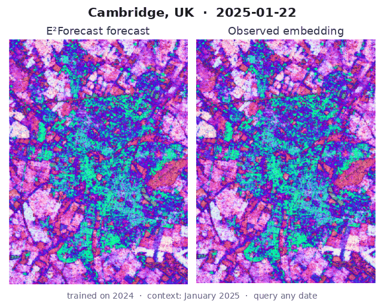
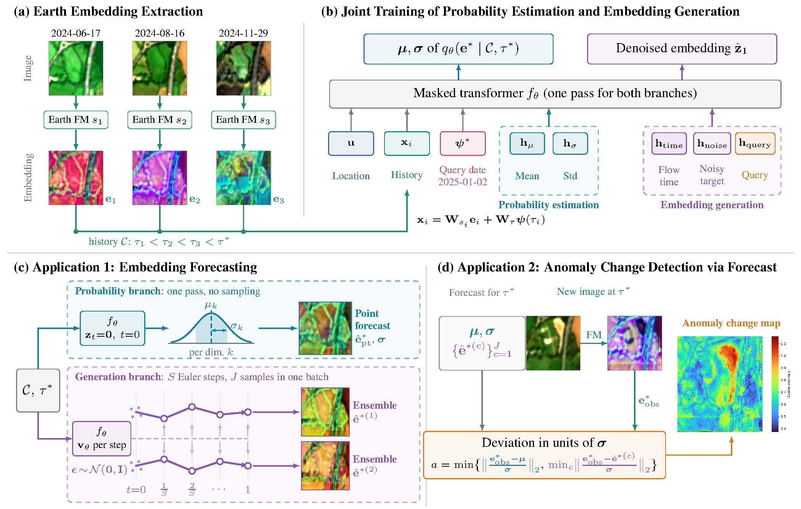
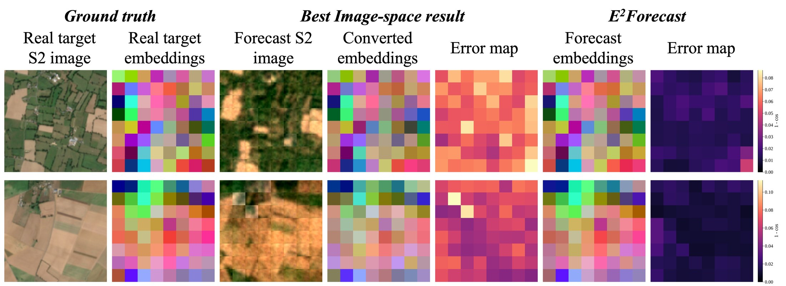
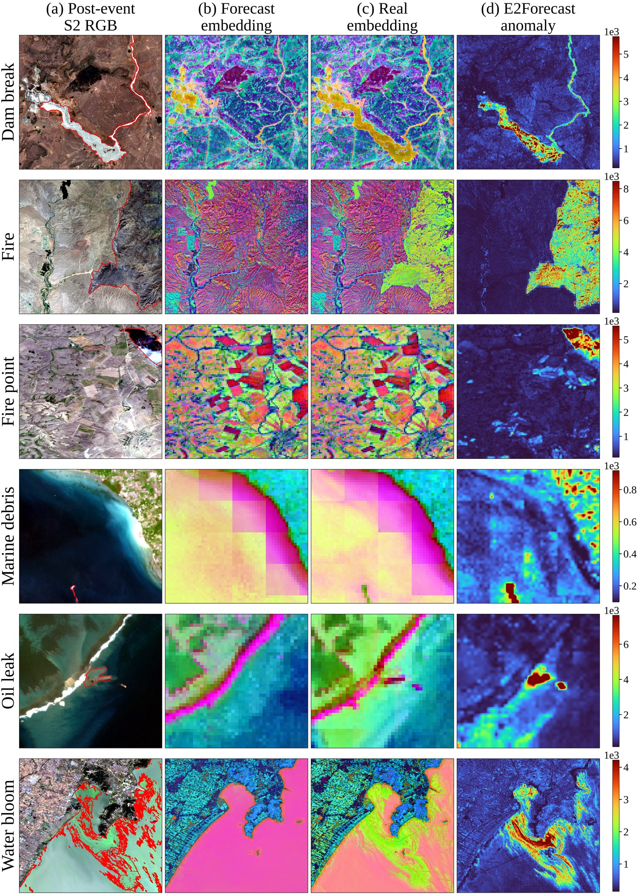
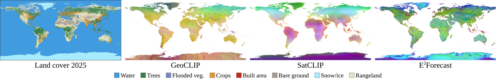
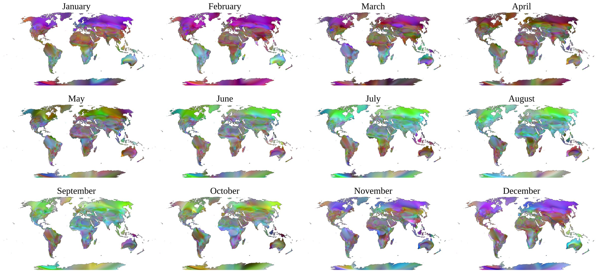

<div align="center">

# E²Forecast

### Forecasting Earth Surface Change in Embedding Space

**Jingtao Li**<sup>1</sup> · **Sadiq Jaffer**<sup>1</sup> · **Anil Madhavapeddy**<sup>1</sup> · **Pedro Sousa**<sup>1</sup> · **Anthony Ortiz**<sup>2</sup><br>
**Kyle Gao**<sup>3</sup> · **Zhengpeng Feng**<sup>1</sup> · **Yanfei Zhong**<sup>4</sup> · **Srinivasan Keshav**<sup>1</sup>

<sup>1</sup>University of Cambridge · <sup>2</sup>Microsoft AI for Good Research Lab · <sup>3</sup>Aalto University · <sup>4</sup>Wuhan University

[](https://github.com/ucam-eo/e2forecast)
[](https://huggingface.co/JingtaoLi/E2Forecast)
[](https://huggingface.co/datasets/JingtaoLi/E2Forecast-data)
[](https://creativecommons.org/licenses/by-nc/4.0/)



<em>Trained on 2024 and given only January 2025 as context, E²Forecast forecasts the OlmoEarth embedding of
Cambridge for any date of 2025. Left: forecast; right: what the satellite saw.</em>

</div>

---

Satellite images are noisy: clouds, shadows and sensor artefacts make pixel-space forecasters spend their capacity on
low-level signal. **E²Forecast forecasts in the embedding space of Earth foundation models instead.** It takes an
irregular history of embeddings from any sensor or foundation model and forecasts the embedding at **any query date**,
both as a point forecast with per-dimension uncertainty and as an ensemble of plausible futures.

## ✨ Highlights

- 🛰️ **Any sensor, any foundation model, any date.** One token space handles irregular histories from Sentinel-1
  and Sentinel-2, and embeddings from OlmoEarth, Prithvi-EO-2.0 and SatCLIP.
- 🎯 **Two branches in one pass.** A probability branch gives `μ, σ`; a rectified-flow branch generates `J`
  ensemble forecasts in `S` Euler steps.
- 📉 **Embeddings beat pixels.** Moving forecasters from pixels to embeddings **halves the cosine distance
  (0.20 → 0.10)** and cuts overconfidence (std of z **2.63 → 1.22**).
- 🔥 **Anomaly change detection for free.** No labels and no retraining: comparing a new observation with the
  forecasts raises F₁ on the global GSA benchmark from **41.58 to 48.70**.
- 🌍 **A global implicit neural representation.** With an empty history, E²Forecast maps a location (and date)
  to an embedding. It is the only location encoder that is positive on all five region-disjoint regression tasks
  (average R² **0.4569** vs. 0.0593 for the best baseline).

## 🧭 Method

<p align="center"></p>

**(a)** Images are embedded by an Earth foundation model. **(b)** Location, history (embedding + date) and query
date tokens feed one masked Transformer. The probability-estimation tokens `h_μ, h_σ` cannot attend to the
generation tokens (flow time, noisy target, query), so both branches train jointly in one pass with
`L = L_nll + L_flow`. **(c)** At inference the same network gives a point forecast `μ/‖μ‖` with uncertainty `σ`,
or `J` ensemble forecasts. **(d)** A new observation that is far from both the Gaussian forecast and every ensemble
member, measured in units of `σ`, is an anomalous change.

## 🖼️ Results

### Forecasting in embedding space keeps what matters

<p align="center"></p>

A forecast Sentinel-2 image can *look* right and still lose the information the foundation model extracts: once the
best image-space forecast is converted to embeddings, its error is large everywhere. E²Forecast forecasts the
embeddings directly, and its error map stays close to zero.

### Anomaly change detection without labels

<p align="center"></p>

The forecast embedding matches the observed one everywhere except where the event happened, so the anomaly score
lights up dam breaks, burned areas, fire points, marine debris, oil leaks and water blooms. One model covers all
six categories, with no category-specific design.

### A global field of embeddings, and its seasons

<p align="center"></p>

Queried on a 0.5° grid and projected to RGB, the E²Forecast field follows coastlines, ice sheets, deserts and the
tropical and boreal forests of the 2025 land-cover map, although it never saw a land-cover label. With a query-date
token, the same model also learns the seasons; after removing each location's annual mean, the Northern and
Southern Hemispheres change in antiphase:

<p align="center"></p>

## 🚀 Getting started

```bash
git clone https://github.com/ucam-eo/e2forecast.git && cd e2forecast
conda create -n e2forecast python=3.12 && conda activate e2forecast
pip install torch                 # pick the build that matches your CUDA version
pip install -r requirements.txt && pip install -e .

hf download JingtaoLi/E2Forecast --local-dir checkpoints     # 5 checkpoints, ~0.5 GB
```

```python
import torch
from e2forecast import load_pretrained, relative_dates

model, checkpoint = load_pretrained("s1_embed", torch.device("cuda"))  # or load_model("checkpoints/s1_embed.pt", ...)
obs_dates, query_date = relative_dates(context_doys, query_doy)     # (B, C) and (B,) day of year
conditions = dict(obs=context,                                      # (B, C, D) L2-normalised history
                  obs_dates=obs_dates, query_date=query_date,
                  lonlat=lonlat)                                    # (B, 2) degrees
mu, sigma = model.gaussian(**conditions)                            # probability branch
point = model.point_forecast(**conditions)                          # mu / ||mu||
ensemble = [model.sample(steps=10, **conditions) for _ in range(10)]  # J = 10 ensemble forecasts
```

## 📦 Checkpoints

| checkpoint | experiment | embedding | history |
| --- | --- | --- | --- |
| [`s1_embed.pt`](https://huggingface.co/JingtaoLi/E2Forecast/resolve/main/s1_embed.pt) | S1_Embed forecasting | OlmoEarth-nano, 128-D | 7 observations |
| [`s2_embed.pt`](https://huggingface.co/JingtaoLi/E2Forecast/resolve/main/s2_embed.pt) | S2_Embed forecasting | Prithvi-EO-2.0-300M, 1024-D | 37 observations |
| [`gsa.pt`](https://huggingface.co/JingtaoLi/E2Forecast/resolve/main/gsa.pt) | GSA anomaly change detection | OlmoEarth-nano, 128-D | 3 observations |
| [`inr.pt`](https://huggingface.co/JingtaoLi/E2Forecast/resolve/main/inr.pt) | INR on S2-100K | SatCLIP, 256-D | none |
| [`inr_date.pt`](https://huggingface.co/JingtaoLi/E2Forecast/resolve/main/inr_date.pt) | INR with query date on SSL4EO-S12 | SatCLIP, 256-D | none |

Every checkpoint stores its model configuration, so each script rebuilds the network from the file alone.

## 📥 Data

All released data is in the HuggingFace dataset
[**JingtaoLi/E2Forecast-data**](https://huggingface.co/datasets/JingtaoLi/E2Forecast-data). Download only the
folders you need, into `data/`:

| to reproduce | download | size | command |
| --- | --- | --- | --- |
| S1_Embed forecasting | `S1_Embed/` | 48 GB | `hf download JingtaoLi/E2Forecast-data --repo-type dataset --include "S1_Embed/*" --local-dir data` |
| S2_Embed forecasting | `S2_Embed/` | 15 GB | `hf download JingtaoLi/E2Forecast-data --repo-type dataset --include "S2_Embed/*" --local-dir data` |
| INR training | `INR/` | 97 MB | `hf download JingtaoLi/E2Forecast-data --repo-type dataset --include "INR/*" --local-dir data` |
| INR downstream probes | third-party, see below | 10 MB | — |
| GSA anomaly detection | not released yet | — | — |

Evaluating a released checkpoint only needs that experiment's data plus the checkpoint; training needs the same data.

The INR downstream probes use third-party data that we do not redistribute. Put these files in `data/downstream/`:

- `labels_population.csv` and `labels_elevation.csv` from the [SatCLIP](https://github.com/microsoft/satclip) downstream tasks;
- `stationDataAll.csv`, the station air temperatures of Hooker et al. (2018), [download](https://springernature.figshare.com/ndownloader/files/12609182);
- California Housing is fetched automatically by scikit-learn.

The GSA embeddings and the dated SSL4EO-S12 shards (used to train `inr_date.pt`) will be released later; the
released `gsa.pt` and `inr_date.pt` can be used without them.

After downloading, `data/` looks like:

```
data/
├── S1_Embed/
│   ├── embeddings/            <site>/<year>/<timestamp>_..._128d.tif, embedding_manifest.json
│   └── config/                split.json, {val,test}_config.json, {val,test}_config_items.npz
├── S2_Embed/
│   ├── embeddings_prithvi_eo_2_300M/   S2_<patch>.npy, (T, 8, 8, 1024) float16
│   ├── benchmark_config/      config.json, split_1461_486_486.json, {val,test}_samples.npz
│   └── PASTIS/metadata.geojson
├── INR/satclip_s2_100k/       satclip_embeddings_location_{000493..000542}.tar
├── downstream/                labels_population.csv, labels_elevation.csv, stationDataAll.csv
└── gsa_manifest.json          (in the repository) the 55 GSA events
```

## 🔁 Reproducing the paper

All commands run from the repository root, with the data laid out as in [Data](#-data).

<details>
<summary><b>Forecasting on S1_Embed and S2_Embed</b></summary>

```bash
python scripts/s1_embed/evaluate.py --data-root data/S1_Embed --checkpoint checkpoints/s1_embed.pt --output-dir results/s1_embed
python scripts/s2_embed/evaluate.py --data-root data/S2_Embed --checkpoint checkpoints/s2_embed.pt --output-dir results/s2_embed \
    --samples-limit 100000
```

The Gaussian branch gives the mean and std of `z`, the point cosine distance and the CRPS (closed form). `J = 10`
ensemble forecasts with `S = 10` Euler steps give the ensemble cosine distance (the closest member). S1_Embed uses
all 1,000,000 test items; S2_Embed uses the first 100,000 test samples.

| | mean z | std z | point cos. ↓ | ensemble cos. ↓ | CRPS ↓ |
| --- | --- | --- | --- | --- | --- |
| S1_Embed | −0.0005 | 1.1376 | 0.1081 | 0.0911 | 0.0213 |
| S2_Embed | 0.0006 | 1.0250 | 0.0667 | 0.0613 | 0.0038 |

Training uses the paper settings by default:

```bash
python scripts/s1_embed/train.py --data-root data/S1_Embed --output-dir runs/s1_embed   # 600 epochs, batch 256
python scripts/s2_embed/train.py --data-root data/S2_Embed --output-dir runs/s2_embed   # 72 epochs, batch 64, 8 heads
```

</details>

<details>
<summary><b>Anomaly change detection on GSA</b></summary>

```bash
python scripts/gsa/train.py --embedding-root data/GSA/embeddings_patch5 --output-dir runs/gsa
python scripts/gsa/infer.py --checkpoint checkpoints/gsa.pt --embedding-root data/GSA/embeddings_patch5 \
    --label-root data/GSA/original --output-dir results/gsa
python scripts/gsa/evaluate.py --results-root results/gsa --label-root data/GSA/original
```

For every event, the last image is the observation and the three images before it are the context. The score map
holds `a² = min(‖(e−μ)/σ‖², min_j ‖(e−ê_j)/σ‖²)` with `J = S = 10`. It is computed on the 50 m embedding grid and
bilinearly upsampled to the 10 m labels. Evaluation follows HyperFree / ESIA: false positives get weight 0.5 in the
precision, one threshold is tuned per category, and event F₁ is averaged within each category and then over
categories. Expected averages: recall 65.48, precision 48.84, F₁ 48.70.

The GSA embeddings are not released yet; `data/gsa_manifest.json` lists the 55 events.

</details>

<details>
<summary><b>E²Forecast as an implicit neural representation</b></summary>

```bash
python scripts/inr/train.py --shards 'data/INR/satclip_s2_100k/satclip_embeddings_location_{000493..000542}.tar' \
    --output-dir runs/inr
python scripts/inr/downstream.py --checkpoint checkpoints/inr.pt --data-dir data/downstream --output results/inr_downstream.json
python scripts/inr/plot_global_field.py --checkpoint checkpoints/inr.pt --output figures/global_field.png

# date-conditioned model (the SSL4EO-S12 shards are not released yet)
python scripts/inr/train.py --query-date --shards '<ssl4eo_shards>_{000000..000492}.tar' --output-dir runs/inr_date
python scripts/inr/plot_global_monthly.py --checkpoint checkpoints/inr_date.pt --output figures/global_monthly.png
```

The probe regresses each target from the normalised Gaussian mean at the sample's location. Splits are
region-disjoint (30/10/60 % latitude or longitude bands with 0.25° guard gaps), and the probe is an MLP with one
hidden layer of width 32. The probe-selection rule is the same as for every baseline in the paper (see
`scripts/inr/downstream.py`). The probe data goes in `data/downstream/` (see [Data](#-data)).

| population | elevation | temperature | house value | income | **average** |
| --- | --- | --- | --- | --- | --- |
| 0.6064 | 0.1687 | 0.7628 | 0.2183 | 0.5282 | **0.4569** |

</details>

<details>
<summary><b>Repository layout</b></summary>

```
e2forecast/                 installable package
  model.py                  E2ForecastNetwork, E2Forecast (loss, Gaussian forecast, flow sampling), encodings
  location.py               fixed GeoCLIP random-Fourier-feature location encoder
  training.py               shared training loop (AdamW, checkpoints, resume, validation)
  metrics.py                z-score, point / ensemble cosine distance, CRPS
  anomaly.py                anomaly score, upsampling, GSA threshold evaluation
  checkpoint.py             checkpoint format and loading
  globe.py                  global-field plotting helpers
  data/                     s1_embed.py, s2_embed.py, gsa.py, satclip.py
scripts/
  s1_embed/                 train.py, evaluate.py
  s2_embed/                 train.py, evaluate.py
  gsa/                      train.py, infer.py, evaluate.py
  inr/                      train.py, evaluate.py, downstream.py, plot_global_field.py, plot_global_monthly.py
  export_checkpoint.py      convert checkpoints of the original research code to the release format
data/gsa_manifest.json      the 55 GSA events (relative paths, dates, bounds)
assets/                     README figures
```

</details>

## 📜 License

Code, checkpoints and data are released under [CC BY-NC 4.0](https://creativecommons.org/licenses/by-nc/4.0/):
free for research and other non-commercial use, with attribution.

## 📝 Citation

```bibtex
@article{li2026e2forecast,
  title  = {Forecasting Earth Surface Change in Embedding Space},
  author = {Li, Jingtao and Jaffer, Sadiq and Madhavapeddy, Anil and Sousa, Pedro and Ortiz, Anthony and
            Gao, Kyle and Feng, Zhengpeng and Zhong, Yanfei and Keshav, Srinivasan},
  year   = {2026}
}
```
